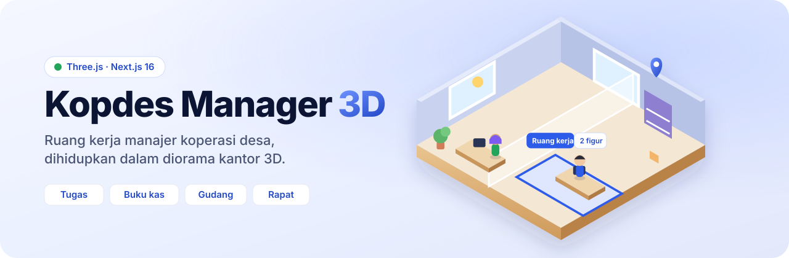
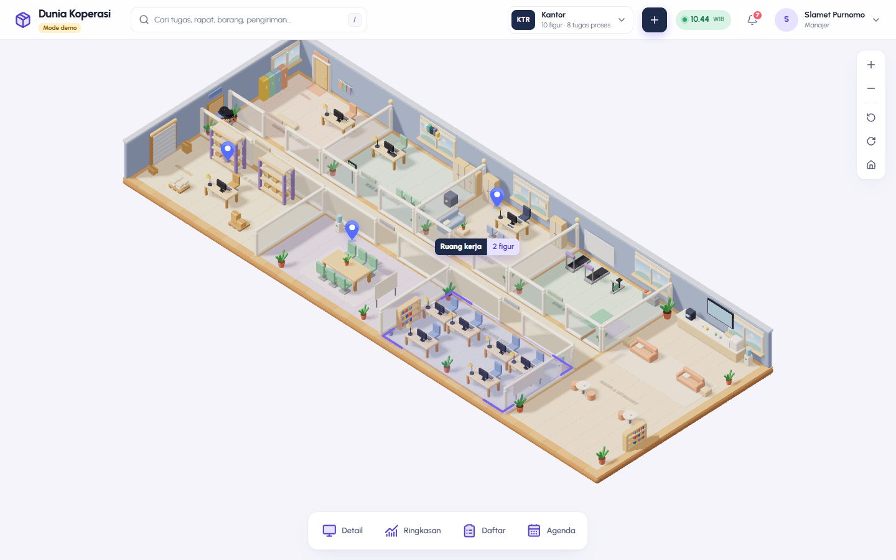
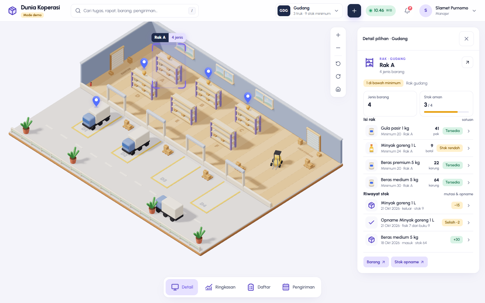
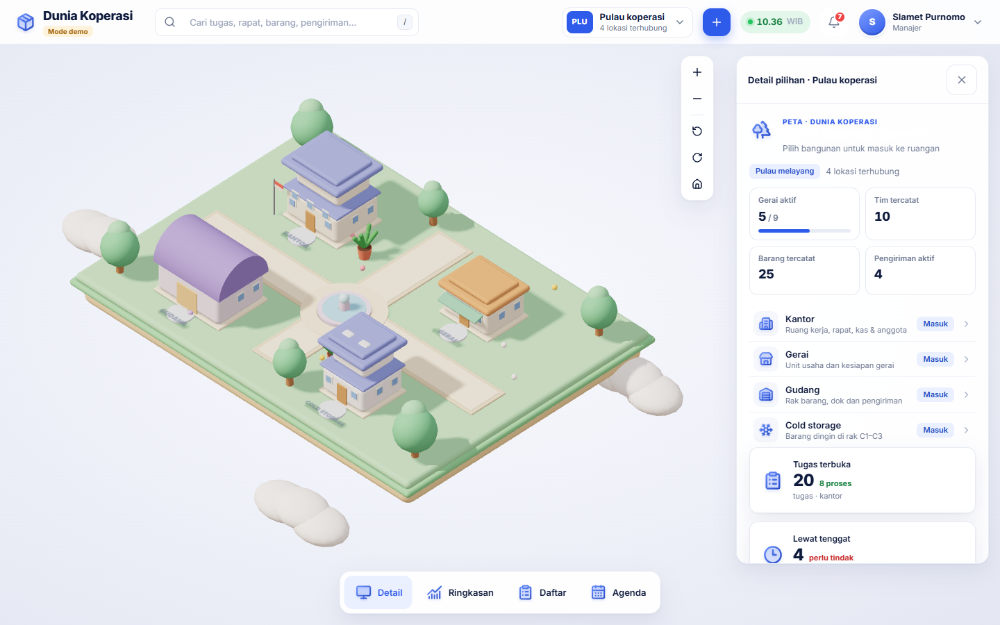
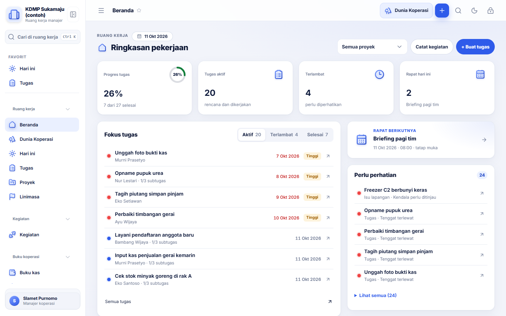
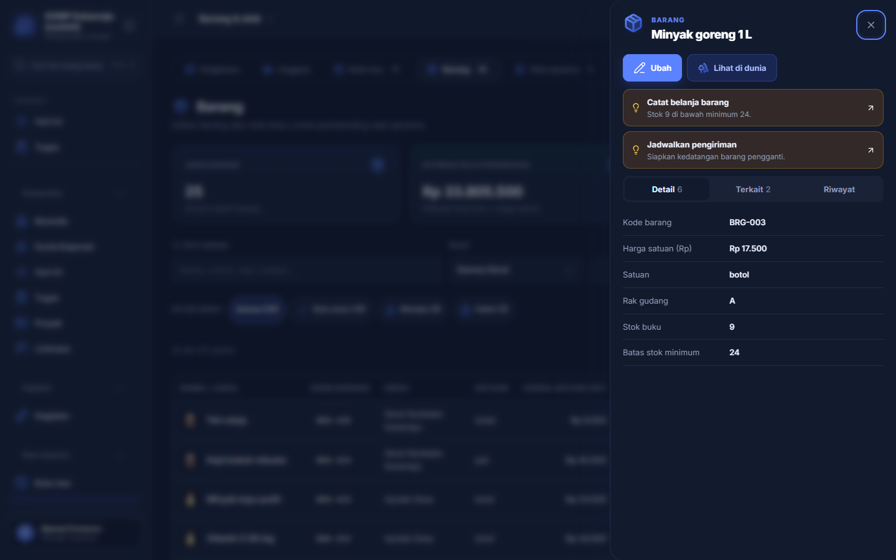
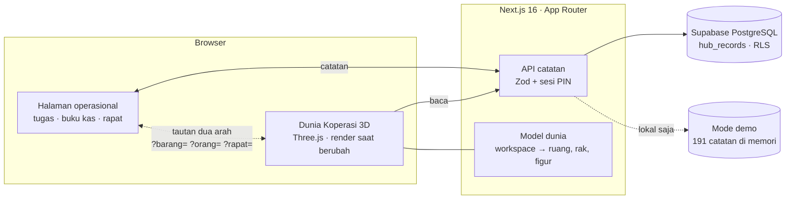

<div align="center">



<p>
  <a href="https://github.com/halimxn/kopdes-manager-3d/actions/workflows/ci.yml"></a>
  
  
  
  
  
</p>

**Ruang kerja manajer koperasi desa — tugas, buku kas, gudang, dan rapat — dihidupkan dalam diorama kantor 3D yang membaca data yang sama.**

[Coba mode demo](#-coba-dalam-satu-menit) · [Galeri](#-galeri) · [Arsitektur](#-arsitektur) · [Dokumentasi](#-dokumentasi)

</div>

---



## Tentang

**Kopdes Manager 3D** adalah aplikasi web untuk manajer Koperasi Desa/Kelurahan Merah Putih (KDMP). Satu tempat untuk merencanakan proyek, membagi tugas, mencatat uang masuk/keluar, mengelola barang dan stok, menjadwalkan pengiriman, serta menyiapkan rapat dan laporan.

Yang membuatnya berbeda adalah **Dunia Koperasi**: diorama 3D isometrik yang seluruh modelnya dibangun dari kode dengan Three.js. Kantor, gerai, gudang, dan cold storage menampilkan data asli. Truk di dok berasal dari catatan pengiriman, rak gudang berisi barang yang tercatat, dan figur staf berpindah ruang mengikuti rapat, kegiatan, serta tugasnya. Setiap objek bertautan ke catatan aslinya, dan setiap catatan bisa dibuka di dunia.

> [!NOTE]
> Prinsip utama: **tanpa data karangan.** Bila tabel belum aktif atau data kosong, aplikasi menampilkan "belum aktif" atau "—", bukan angka nol palsu. Buku kas hanya mencatat uang masuk dan keluar; selisihnya tidak pernah disebut saldo atau laba.

## ✨ Sorotan

<table>
  <tr>
    <td width="50%" valign="top">
      <h3>🏢 Dunia Koperasi 3D</h3>
      Lima lokasi dalam satu kanvas: pulau melayang, kantor delapan ruang, sepuluh unit gerai, gudang dengan rak A–F dan dok D1–D4, serta cold storage. Kamera mengikuti figur pilihan, pin hanya muncul untuk hal yang perlu perhatian, dan render berhenti saat diam supaya ringan di laptop desa.
    </td>
    <td width="50%" valign="top">
      <h3>🔗 Terhubung dua arah</h3>
      Tombol <b>Lihat di dunia</b> di catatan unit, staf, barang, pengiriman, tugas, dan rapat membuka objek yang tepat di diorama. Dari dunia, setiap baris panel membuka catatan aslinya dan aksi "buat baru" membuka formulir web yang sudah terisi.
    </td>
  </tr>
  <tr>
    <td valign="top">
      <h3>📋 Tugas & proyek</h3>
      Proyek fleksibel tanpa durasi wajib, tugas dengan daftar, papan, kalender, linimasa Gantt, dan tampilan harian. Ada juga subtugas, dependensi, pengulangan, milestone, sprint, dan catatan terformat.
    </td>
    <td valign="top">
      <h3>📒 Buku koperasi</h3>
      Anggota, buku kas, barang, stok opname, pengiriman, dan mutasi stok. Laci detail menampilkan catatan <b>Terkait</b> dua arah serta saran langkah berikut, misalnya stok di bawah minimum → <i>Catat belanja</i>.
    </td>
  </tr>
  <tr>
    <td valign="top">
      <h3>📱 Siap di semua layar</h3>
      Diperiksa di 360, 768, 1024, dan 1440 px. Di ponsel dan tablet, tabel lebar berubah menjadi kartu, detail tampil sebagai lembar bawah, dan diorama mendukung geser serta cubit. Mode gelap tersedia.
    </td>
    <td valign="top">
      <h3>🔒 Aman sejak awal</h3>
      Masuk dengan PIN yang di-hash scrypt, batas percobaan, sesi kedaluwarsa, cookie HttpOnly/SameSite, dan pemeriksaan asal mutasi. Database memakai Row Level Security dan setiap aksi server divalidasi Zod.
    </td>
  </tr>
</table>

## 🖼 Galeri

| Gudang | Pulau melayang |
|---|---|
|  |  |
| **Beranda** | **Laci detail (mode gelap)** |
|  |  |

## 🚀 Coba dalam satu menit

Mode demo menjalankan seluruh aplikasi dengan **191 catatan contoh di memori**, tanpa Supabase dan tanpa PIN. Prasyarat: Node.js 22 dan npm.

```sh
git clone https://github.com/halimxn/kopdes-manager-3d.git
cd kopdes-manager-3d
npm ci
npm run dev:demo
```

Buka `http://127.0.0.1:3000/beranda`, lalu menu **Dunia Koperasi**. Perubahan di mode demo hanya tersimpan di memori server dan hilang saat server dimatikan. Mode demo tidak pernah aktif di Vercel.

## 🗄 Memakai data asli

1. Buat proyek Supabase **baru**, lalu jalankan `supabase/install/INSTALL_SCHEMA_KOSONG.sql` di SQL Editor. Panduan: [docs/SUPABASE.md](docs/SUPABASE.md).
2. Salin `.env.example` menjadi `.env.local`, lalu isi `HUB_SUPABASE_URL`, `HUB_SUPABASE_SERVICE_KEY`, `HUB_SETUP_TOKEN` (acak, minimal 32 karakter), dan `HUB_APP_ORIGIN`.
3. Jalankan `npm run dev`, buka `http://127.0.0.1:3000/pin`, dan buat PIN pertama memakai token pengaturan.
4. Opsional: isi data contoh dengan `supabase/seed/SEED_DATA_CONTOH.sql`, lalu hapus kapan saja dengan `HAPUS_DATA_CONTOH.sql`.

> [!IMPORTANT]
> Kunci Supabase hanya dipakai server dan tidak pernah dikirim ke browser. `localhost` dan `127.0.0.1` dianggap origin berbeda, jadi samakan dengan `HUB_APP_ORIGIN`.

## 🧰 Perintah

| Perintah | Fungsi |
|---|---|
| `npm run dev` | Server pengembangan dengan Supabase |
| `npm run dev:demo` | Server pengembangan dengan data contoh di memori |
| `npm test` | Seluruh tes Vitest: unit, UI, database (PGlite), keamanan |
| `npm run typecheck` | Pemeriksaan TypeScript strict |
| `npm run lint` | ESLint |
| `npm run build` | Build produksi Next.js |
| `npm run seed:contoh` | Membuat ulang SQL seed dan hapus data contoh |

Tes database memakai PostgreSQL lokal (PGlite) dan tidak menyentuh Supabase cloud.

## 🏗 Arsitektur



| Lapisan | Teknologi |
|---|---|
| Antarmuka | Next.js 16 App Router, React 19, TypeScript strict, Tailwind 3, Inter |
| Dunia 3D | Three.js: geometri digabung, render sesuai permintaan, DPR maks. 1,5, tanpa pascaproses |
| Data | Supabase PostgreSQL, satu tabel JSONB `hub_records` dengan skema Zod per domain, RPC atomik untuk mutasi stok |
| Keamanan | PIN scrypt, token sesi SHA-256, RLS tolak-bawaan, pemeriksaan Origin |
| Kualitas | Vitest + Testing Library + jsdom, PGlite, ESLint, CI GitHub Actions |

### Struktur folder

```text
src/
├── app/                 # Rute, API, pratinjau /dev
├── components/          # UI bersama: AppShell, tombol, modal, ikon dua nada
├── features/
│   ├── dunia-3d/        # Dunia Koperasi 3D dan kartu monitoring
│   │   └── model/       # Adapter workspace → dunia, unit → bangunan, jadwal figur
│   ├── records/         # Catatan, laci detail, Terkait, saran, skema Zod
│   ├── operations/      # Buku kas, anggota, barang, stok opname
│   ├── tasks/ projects/ # Tugas, proyek, milestone, linimasa
│   ├── dashboard/       # Beranda dan Hari ini
│   └── demo/            # Data contoh mode demo
└── lib/                 # Supabase, sesi, progres, tanggal Asia/Jakarta
supabase/                # Migrasi berurutan, SQL install/reset, seed
tests/                   # unit · ui · database · security
docs/                    # Kontrak dunia, status, desain, database
```

## 📚 Dokumentasi

| Dokumen | Isi |
|---|---|
| [Dunia Koperasi](docs/DUNIA-KOPERASI.md) | Kontrak gaya, tata ruang, data, performa, dan peta kode dunia 3D |
| [Desain antarmuka](docs/DESAIN-ANTARMUKA.md) | Pola halaman, tabel, kartu, warna, dan judul |
| [Arsitektur](docs/ARSITEKTUR.md) | Alur data, transaksi, dan keamanan |
| [Supabase](docs/SUPABASE.md) · [Migrasi SQL](docs/MIGRASI-SQL.md) · [Reset](docs/RESET-DATABASE.md) | Penyiapan dan perubahan database |
| [Status](docs/STATUS.md) · [Checklist](docs/CHECKLIST.md) | Keadaan terkini dan penerimaan |
| [Peta dokumen](docs/README.md) | Semua dokumen lain |

## 🤝 Kontribusi

Baca [CONTRIBUTING.md](CONTRIBUTING.md) untuk aturan cabang (`fitur/`, `perbaikan/`, `tampilan/`, `dokumen/`, `rapikan/`), format commit, dan pemeriksaan sebelum pull request. Agen AI mengikuti [AGENTS.md](AGENTS.md); skill proyek ada di `.claude/skills/`.

## 🧭 Status

Fitur web dan dunia lengkap untuk penggunaan lokal dan mode demo. Penerimaan di perangkat fisik, uji data cloud, dan deployment produksi belum selesai; rinciannya di [docs/STATUS.md](docs/STATUS.md). Riwayat perubahan ada di [CHANGELOG.md](CHANGELOG.md).

## Lisensi

Belum ada lisensi terbuka. Kode dapat dibaca, tetapi hak cipta sepenuhnya milik pemilik repo sampai lisensi ditetapkan.
